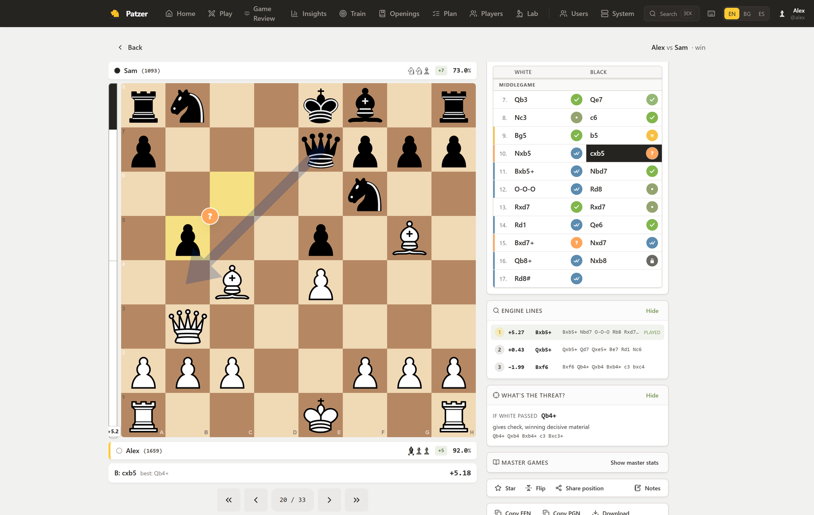
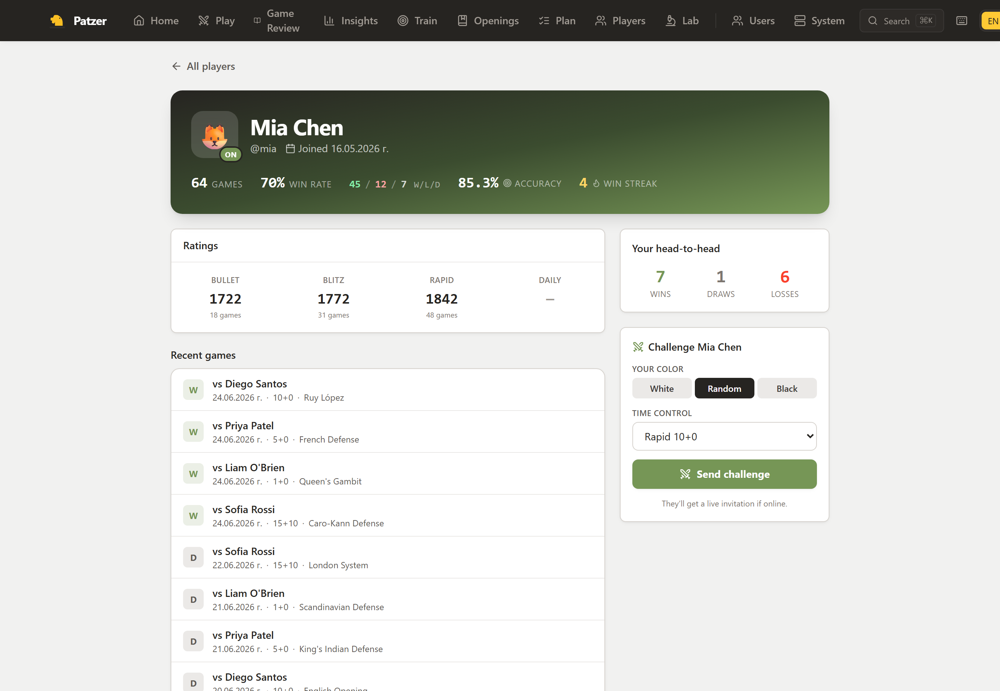
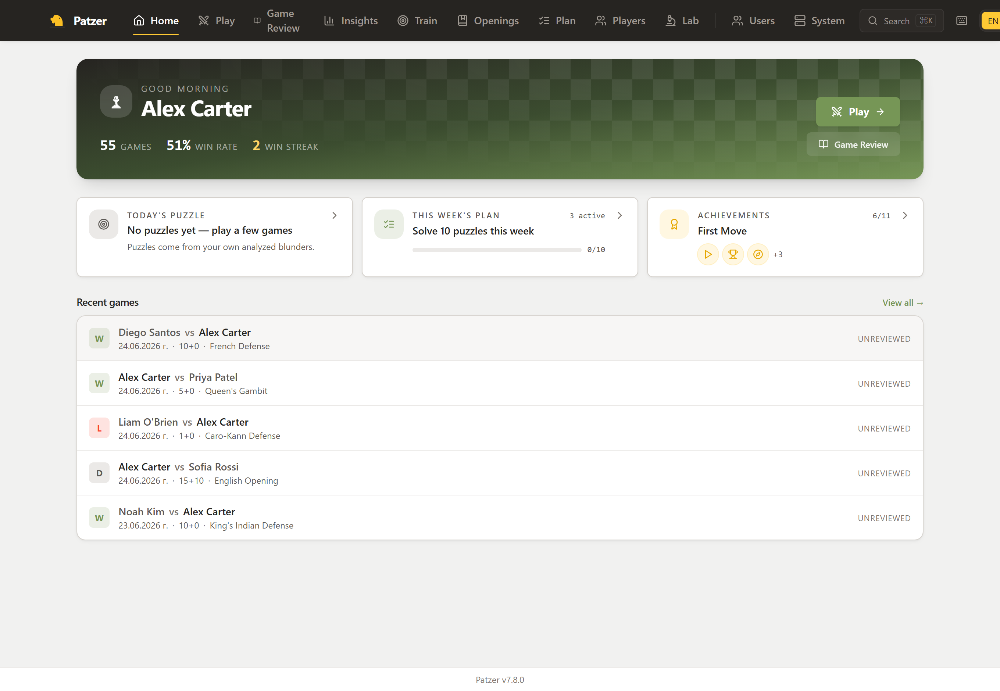
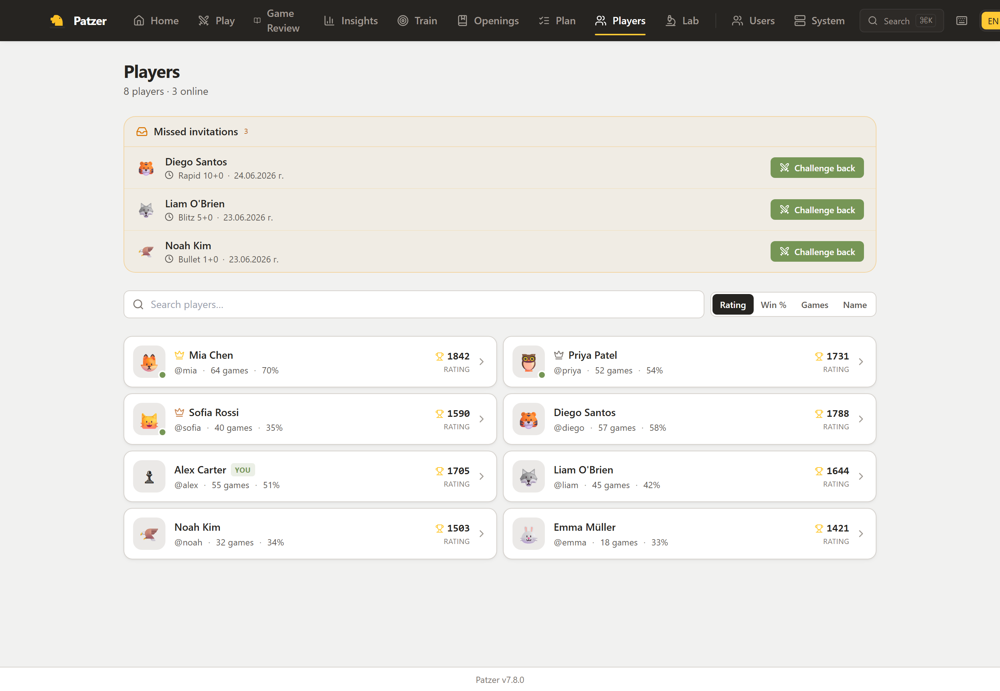
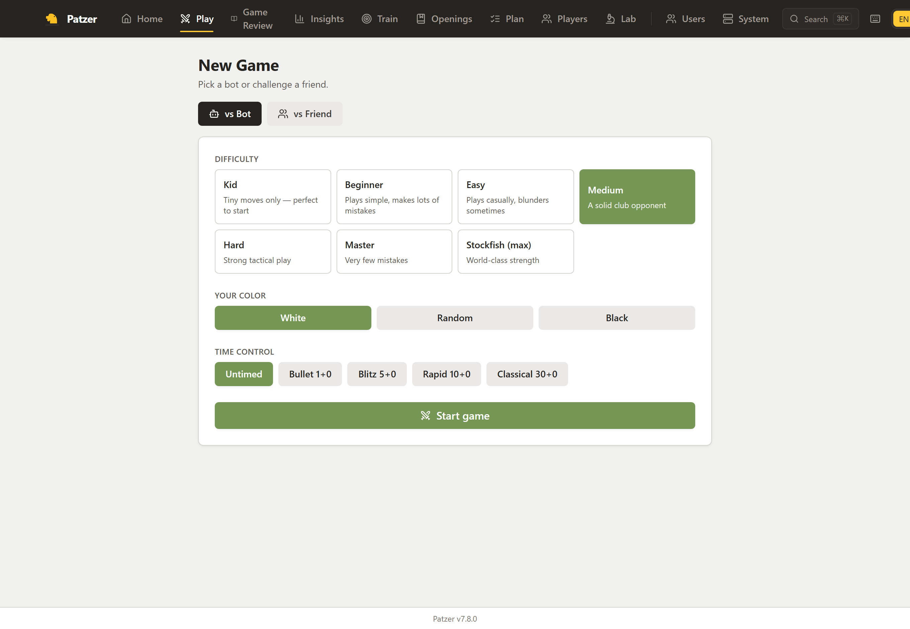
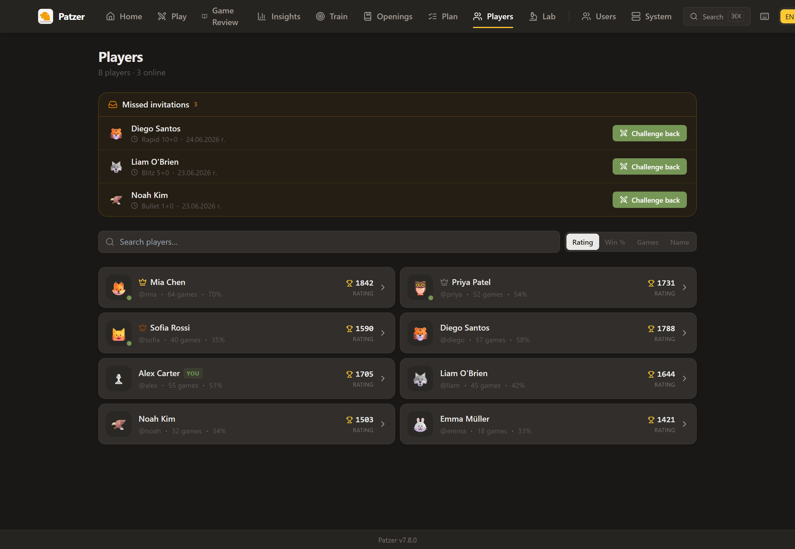
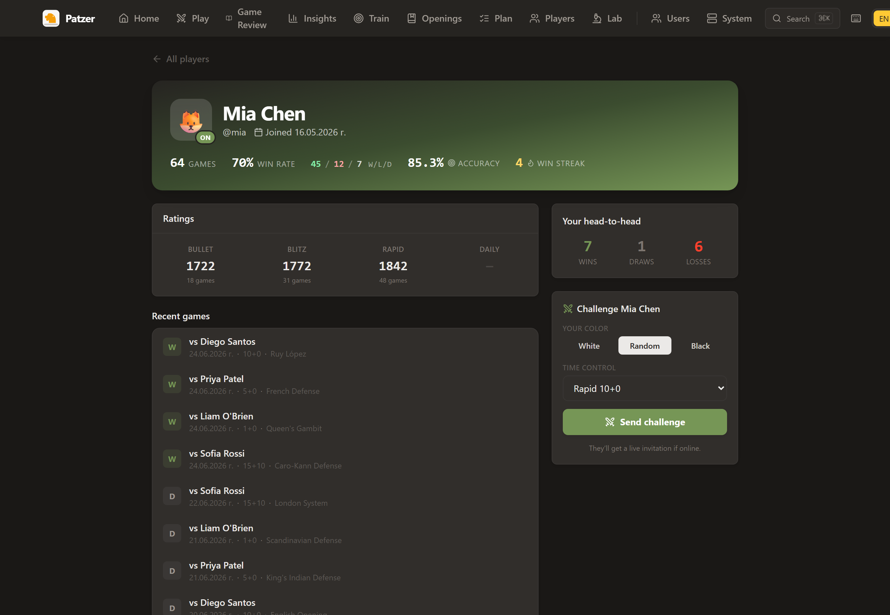
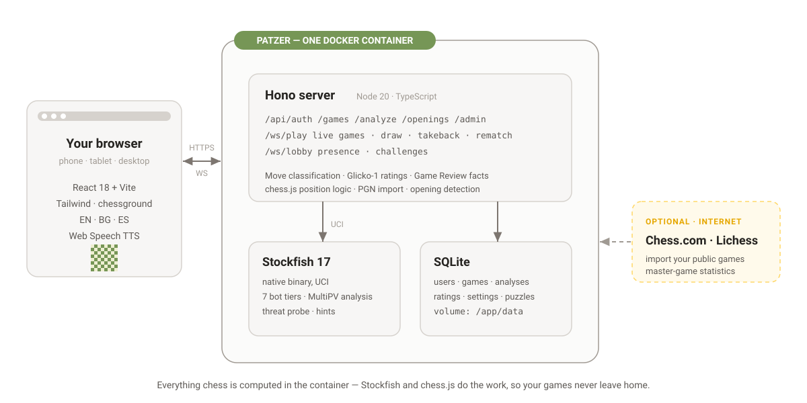

<p align="center">
  
</p>

<h1 align="center">Patzer</h1>

<p align="center">
  <b>Your private Chess.com.</b> Self-hosted, family-friendly.<br/>
  Stockfish + chess.js, in one Docker container.
</p>

<p align="center">
  <a href="https://codespaces.new/SikamikanikoBG/patzer?quickstart=1">
    
  </a>
</p>

<p align="center">
  <a href="https://github.com/SikamikanikoBG/patzer/releases"></a>
  <a href="https://github.com/SikamikanikoBG/patzer/pkgs/container/patzer"></a>
  <a href="LICENSE"></a>
  <a href="https://github.com/SikamikanikoBG/patzer/actions/workflows/ci.yml"></a>
  <a href="https://github.com/SikamikanikoBG/patzer/stargazers"></a>
  <a href="https://www.opensourcealternatives.to"></a>
</p>

<p align="center">
  <picture>
    <source media="(prefers-color-scheme: dark)" srcset="docs/screenshots/analyzer-dark.png">
    
  </picture>
  <br/>
  <sub><b>Game Review</b> — every move classified, top engine lines, and <i>What's the threat?</i> answering in plain words. <i>Demo accounts, Morphy's Opera Game.</i></sub>
</p>

## Why Patzer

- **Your games stay home.** Single Docker container on a Pi / NAS / old laptop. No cloud, no telemetry, no upsell.
- **Everything is computed at home.** Stockfish and chess.js work out every fact server-side — classifications, accuracy, evals — inside the container, so the analysis never leaves your network.
- **Made for a household, not a stadium.** Multi-user with admin console, per-profile language, kid-mode blunder warnings, "horsey" piece names for the youngest profiles.

## What it is

Patzer is a tiny, self-hosted take on the Chess.com / Lichess workflow you actually use:

- **Game Review** — pull your public Chess.com or Lichess games (or paste a PGN; Chess.com games can sync on their own), analyze with bundled Stockfish, get chess.com-style classifications (Brilliant / Great / Best / Excellent / Good / Book / Inaccuracy / Mistake / Miss / Blunder), accuracy %, estimated Elo, eval graph, key moments, top engine lines, a "What's the threat?" probe, and master-game statistics for the position.
- **Play vs Bot** — full games against Stockfish at seven named tiers (Kid → Stockfish max), all standard time controls, a queue of up to six premoves shown on the board, kid-mode blunder warnings.
- **Play vs Friend** — real-time PvP between profiles on the same server over WebSocket, with draw offers, takebacks and one-click rematch. Playing across the internet is a tunnel away — see the [FAQ](docs/FAQ.md#can-i-play-a-friend-who-lives-somewhere-else).
- **Players & profiles** — a directory of everyone on your server with a rating leaderboard, live presence and public profiles (record, per-time-class ratings, your head-to-head), challenge-from-profile, and a "missed invitations" rail.
- **Tournaments** — a knockout bracket for your group. An admin creates the tournament and shares one invitation link; players join through it; the admin presses start and the bracket is built. If a round has an odd number of players, the leftover one plays Stockfish at the level the admin picked instead of sitting the round out — the bot never knocks anybody out. Every result is written down, so a restart or a crash mid-tournament loses nothing.
- **Family-ready** — multi-user with admin console, open / invite-only / closed sign-up, per-profile language, kid-mode blunder warnings, "horsey" piece names for the youngest profiles.
- **Single sign-on (optional)** — sign in with Authentik, Keycloak or any other OpenID Connect provider: SSO next to passwords or SSO only, admins chosen by a provider group, automatic accounts, and a logout that ends the provider session too. See [docs/OIDC.md](docs/OIDC.md).
- **Learn (beta)** — 69 interactive lessons in four levels, from how the pieces move to tactics, mating patterns and endgames. Stars and progress per profile; kid mode tells the same lessons in simpler words.
- **Opening trainer (beta)** — drill 16 built-in main lines or any line from your own repertoire; the moves you miss come back in a daily review queue.
- **Multilingual** — English, Bulgarian, Spanish, German and Russian out of the box, UI and lesson texts. Adding a language is one table entry per file — see CONTRIBUTING.
- **Self-hosted, single container** — runs on a Pi, a NAS, an old laptop. Your games never leave home.
- **Phone-friendly** — full-width board, sticky action bar and a swipe-up move list on small screens.
- **Tells you when it's stale** — a self-hosted app can't update itself, but Patzer checks GitHub every six hours and shows a one-line notice when a newer release is out, so you know to pull. Sends nothing about you; switch it off in *Admin → System*.

## Screenshots

<table>
<tr>
<td width="50%" valign="top">

<br/><sub><b>Player profile</b> — lifetime record, per-time-class ratings, your head-to-head, and a one-click challenge.</sub>
</td>
<td width="50%" valign="top">

<br/><sub><b>Home</b> — your stats, today's puzzle, this week's plan, achievements and recent games.</sub>
</td>
</tr>
<tr>
<td width="50%" valign="top">

<br/><sub><b>Players</b> — everyone on your server, sorted by rating, with live presence and missed invitations.</sub>
</td>
<td width="50%" valign="top">

<br/><sub><b>Play</b> — seven Stockfish tiers, all time controls, or a live challenge to a friend.</sub>
</td>
</tr>
</table>

Dark mode is built in (auto / light / dark, per profile):

<table>
<tr>
<td width="50%" valign="top"></td>
<td width="50%" valign="top"></td>
</tr>
</table>

<sub>All screenshots use anonymized demo data — no real accounts or hostnames.</sub>

## First run in five minutes

Pick **one** of these. The Docker options open <http://localhost:8800>; the Codespaces option opens in your browser. Either way, the first visit walks you through a setup wizard.

**Try it in your browser**

[](https://codespaces.new/SikamikanikoBG/patzer?quickstart=1)

Spins up a temporary Codespace with Patzer + Stockfish pre-installed. Wait ~60 seconds for `npm install` + dev server to start, then click the forwarded port labelled *"Patzer (Vite dev — open this)"*. You get the full app.

**`docker run`**

```bash
docker run -d \
  -p 8800:8800 \
  -v patzer-data:/app/data \
  --name patzer \
  ghcr.io/SikamikanikoBG/patzer:latest
```

**`docker compose`**

```yaml
services:
  patzer:
    image: ghcr.io/SikamikanikoBG/patzer:latest
    container_name: patzer
    restart: unless-stopped
    ports:
      - "8800:8800"
    volumes:
      - patzer-data:/app/data
volumes:
  patzer-data:
```

> **What works without any extras:** play vs Stockfish, play vs friend on the same server,
> move classification, accuracy %, eval graph, opening detection. The setup wizard takes you
> straight to a working board.
>
> **What needs a Chess.com or Lichess username:** importing your public games for review. Without it
> you can still load PGNs by paste or play live and review from the move list.

You'll want, optionally:

- **For Game Review on your own games:** a Chess.com and/or Lichess username (entered later in *Settings*).

To use a different host port, run with `-p 9000:8800` (or set `HOST_PORT=9000` if you're using `docker compose`).

If you're terminating TLS at a reverse proxy, set `COOKIE_SECURE=true` in the container's environment so session cookies aren't shipped over plaintext HTTP.

To sign in through Authentik, Keycloak or another OpenID Connect provider instead of (or next to) Patzer passwords, see [Single sign-on](docs/OIDC.md). With `OIDC_ONLY=true` a fresh install skips the setup wizard below: the first SSO login creates the admin.

## Compared to alternatives

|                        | Patzer | Lichess Studio | Chess.com Review | Aimchess |
| ---------------------- | :----: | :------------: | :--------------: | :------: |
| Self-hosted            |   ✅   |       ❌        |        ❌         |    ❌    |
| Imports Chess.com      |   ✅   |       ❌        |        ✅         |    ✅    |
| Imports Lichess        |   ✅   |       ✅        |        ❌         |    ✅    |
| Multi-user / family    |   ✅   |       ❌        |        ❌         |    ❌    |
| Free                   |   ✅   |       ✅        |        💳         |    💳    |

## How it's built

<p align="center">
  <picture>
    <source media="(prefers-color-scheme: dark)" srcset="docs/diagrams/architecture-dark.svg">
    
  </picture>
</p>

All chess facts are computed server-side: chess.js works out what a move allows, hangs or wins, Stockfish supplies the opponent's best answer and the alternatives, and your own game history feeds the review. The container does the computing; the browser renders what it is given.

## Local development

Requirements: Node.js ≥ 20.11.

```bash
git clone https://github.com/SikamikanikoBG/patzer.git
cd patzer
npm install
npm run setup   # downloads Stockfish 17 into ./bin/ (Windows, Linux, macOS)
npm run dev
```

- Server: <http://localhost:8800>
- Vite dev server (HMR): <http://localhost:5173> — proxies `/api` and `/ws` to the server.

`npm run setup` dispatches to `setup.ps1` (Windows) or `setup.sh` (Linux/macOS) and picks the official
build for your CPU; on an older x86 CPU without AVX2 run `STOCKFISH_ASSET=stockfish-ubuntu-x86-64-sse41-popcnt npm run setup`.
A package-manager Stockfish (`apt install stockfish` / `brew install stockfish`) works too — the server
also looks in `/usr/bin`, `/usr/local/bin`, `/opt/homebrew/bin` and `/usr/games`.

Useful scripts:

```bash
npm run typecheck   # tsc -b across server + web + tests (no emit)
npm test            # vitest — classifier, Glicko, PGN round-trip, explorer, PvP helpers
npm run test:e2e    # boots a real server on a scratch DB and plays a PvP game over two sockets
npm run build       # production build of both workspaces
```

## Deploying to a home server

The published image plus the `docker compose` snippet above is all most people need — add the
[Watchtower](https://containrrr.dev/watchtower/) label and your box tracks releases by itself.
If you'd rather build from source on the target, two equivalent scripts are bundled — `deploy.ps1` for Windows hosts,
`deploy.sh` for Linux / macOS hosts. Both tar the source, scp it to the
target, then run `docker compose build && up -d` over SSH.

Create `.env.deploy` (gitignored) on the workstation you're deploying *from*:

```
HOST=user@192.168.x.x
REMOTE_DIR=/home/user/patzer
SUDO_PASS=... # only if your user is not in the docker group on the target
HOST_PORT=8800
```

Then:

```powershell
# Windows
.\deploy.ps1            # tar source → ssh, build & start
.\deploy.ps1 -NoBuild   # restart without rebuilding
.\deploy.ps1 -Logs      # tail logs after deploy
```

```bash
# Linux / macOS
./deploy.sh             # tar source → ssh, build & start
./deploy.sh --no-build  # restart without rebuilding
./deploy.sh --logs      # tail logs after deploy
```

## Configuration

All user-facing configuration is done **through the UI** and persisted in SQLite. The only environment variables are operational:

| Var | Default | What it does |
|---|---|---|
| `PORT` | `8800` | HTTP listen port |
| `HOST` | `0.0.0.0` | Bind address |
| `DB_PATH` | `./data/chess.db` | SQLite database file |
| `STOCKFISH_PATH` | (auto) | Override Stockfish binary path |
| `LICHESS_EXPLORER_URL` | `https://explorer.lichess.ovh` | Opening-explorer upstream for the *Master games* panel (a self-hosted `lila-openingexplorer` works) |
| `UPDATE_CHECK` | `1` | Set to `0` to disable the six-hourly "a newer release exists" check for the whole deployment (there's also a toggle in *Admin → System*) |
| `SESSION_SECRET` | (auto-generated) | Cookie signing secret. Persisted on first run. |
| `COOKIE_SECURE`  | `false` | Set to `true` when terminating TLS at a reverse proxy so session cookies are flagged `Secure`. |
| `ENGINE_BACKEND` | `local` | `chessapi` sends Game Review positions to the hosted chess-api.com engine instead of the bundled Stockfish (opt-in — for a Pi or a public demo instance) |
| `CHESSCOM_SYNC_MINUTES` | `15` | How often linked Chess.com accounts are synced, analyzed and reviewed in the background; `0` turns the timer off |
| `PUBLIC_BASE_URL` | (request origin) | Public address of the app, e.g. `https://chess.example.com`. Used for links in emails and the SSO callback; set it behind a reverse proxy. *Admin → System → Public base URL* wins when set |

**Single sign-on** ([full guide](docs/OIDC.md)) is off until `OIDC_ISSUER` and `OIDC_CLIENT_ID` are set:

| Var | Default | What it does |
|---|---|---|
| `OIDC_ISSUER` | (none) | Provider issuer URL, exactly as the provider shows it (keep the trailing `/`) |
| `OIDC_CLIENT_ID` | (none) | Client ID |
| `OIDC_CLIENT_SECRET` | (empty) | Client secret; empty for a public client |
| `OIDC_BUTTON_TEXT` | "Sign in with SSO" | Label of the SSO button on the login page |
| `OIDC_ONLY` | `false` | `true` removes password login, sign-up and password reset, and on a fresh install replaces the setup wizard (the first SSO login is the admin); ignored if SSO isn't configured |
| `OIDC_ADMIN_GROUP` | (none) | Provider group whose members are admins; checked at every SSO login, and until an admin exists only its members can sign in |
| `OIDC_AUTO_PROVISION` | `false` | Create an account for someone the provider lets in who has none yet |
| `OIDC_MATCH_BY` | `none` | Link a first SSO login to an existing account by `username` (case-insensitive) or verified `email`, or `none` |

System settings (Stockfish path override, who can sign up) live in *Admin → System*; account invites in *Admin → Users*; tournaments in *Admin → Tournaments*.
Per-profile settings (language, TTS voice, sound sets, Chess.com / Lichess usernames) live in *Settings*.

## How a tournament runs

1. **Admin → Tournaments → New tournament.** The admin menu (top right, next to your name) has its own *Tournaments* entry — the page opens straight onto the "New tournament" button. Name, time control, and the Stockfish level the bot plays at when a player ends up without an opponent.
2. **Send the invitation link.** It looks like `https://your-server/tournaments/join/ABCDEFGHJK` — the admin console shows it ready to copy, with a share button for phones. A guest who opens it sees what the tournament is; a signed-in player joins with one click (or types the code on the *Tournaments* page).
3. **Nothing happens yet.** The bracket does not exist until the admin presses **Start** — a tournament is the admin's decision, not a race. The console shows who has joined, so the admin can see the guest list before starting.
4. **The door closes at the start.** Once the bracket is built the seats are taken: a newcomer who opens the link afterwards is told the tournament has already started and cannot join. A tournament needs at least two players — the admin's *Start* button stays disabled until then.
5. **Rounds are paired by rating.** The better seed of each pair plays white. When a round has an odd number of players, the leftover one plays Stockfish at the level the admin picked: the bot fills the empty seat, it never knocks anybody out, and the result still counts for the tournament points.
6. **A draw is replayed** — the same two players, a fresh game, nobody eliminated. A tournament is a knockout, and deciding it by rating instead of by playing would be unfair.
7. **The score is the tournament's own.** Tournament games do not move anybody's Glicko rating and stay out of the general record; the standings table on the tournament page has the points (1 win, ½ draw).

Everything is written to SQLite as it happens, so a crash, a restart or a closed laptop mid-tournament costs nothing: the bracket comes back exactly as it was. If a player never shows up, the admin can decide that match under *Admin → Users → Tournaments*.

## How move classification works

Each played move is compared against the engine's best move at the same position. We compute the **win-percentage drop** using the Lichess sigmoid (`50 + 50 · (2 / (1 + exp(-0.00368208 · cp)) − 1)`) and combine it with real centipawn loss as a guard against lopsided positions:

| Classification | Rule |
| --- | --- |
| Best ★ | the engine's #1 move |
| Excellent ✓ | win-% drop < 2 **and** cp loss < 50 |
| Good · | win-% drop < 5 **and** cp loss < 100 |
| Inaccuracy ?! | win-% drop < 10 |
| Mistake ? | win-% drop < 20 |
| Blunder ?? | win-% drop ≥ 20 |

On top of that ladder: **Forced** (only one legal move) and **Book** (the position is in the bundled ECO table) replace the label; **Brilliant** `!!` is the engine's #1 move that leaves ≥ a minor piece en prise — measured with a static exchange evaluation, net of what the move captured — in a position that isn't already crushing, where the engine line doesn't just win the material back; **Great** `!` is the engine's #1 when the second-best move is ≥ 200 cp worse, or a move that lifts a lost position back to equal; **Miss** flags a mistake-or-worse that threw away a clearly winning eval or a forced mate. Same-sign mate transitions (+M3 → +M2) cost nothing. Per-game accuracy is the Lichess formula `103.1668 · exp(-0.04354 · Δwin%) − 3.1669`, clamped to `[0, 100]`, excluding book and forced moves.

Estimated Elo comes from average centipawn loss on a piecewise curve calibrated against chess.com Game Review (ACPL 8 → 2700, 18 → 2200, 25 → 1900, 35 → 1600, 50 → 1400, 70 → 1200, 100 → 900, 150 → 600), with accuracy nudging it ±20 Elo at most. The per-game *performance rating* additionally blends in the opponent's rating, weighted by how settled that rating is. All of this is unit-tested — see `server/test/classifier.test.ts`.

## Tech

- **Server:** Node 20 · TypeScript · [Hono](https://hono.dev) · [better-sqlite3](https://github.com/WiseLibs/better-sqlite3) · [chess.js](https://github.com/jhlywa/chess.js) · `ws` · native [Stockfish](https://stockfishchess.org/)
- **Web:** React 18 · Vite · Tailwind CSS · [chessground](https://github.com/lichess-org/chessground) · framer-motion · react-i18next · TanStack Query
- **Tests:** [vitest](https://vitest.dev) unit suites + an end-to-end PvP run against a real server
- **TTS:** browser Web Speech API (uses installed OS voices)
- **Persistence:** single SQLite file in `./data/`

## Troubleshooting

- **"Stockfish binary not found"** — Patzer no longer falls back to a bare `stockfish` PATH lookup (defense-in-depth: a malicious binary earlier in `$PATH` would otherwise run as the server user). Either install Stockfish into `/usr/games/stockfish`, `/usr/local/bin/stockfish`, `/opt/homebrew/bin/stockfish`, or `bin/stockfish` in the project, or set `STOCKFISH_PATH` (env) / *Admin → System → Stockfish path*.
- **Port 8800 already in use** — `-p 9000:8800` (docker run) or `HOST_PORT=9000 docker compose up -d`.
- **Lost your admin password** — there is no in-app reset yet. Until one ships, edit `chess.db` directly: open `data/chess.db` with `sqlite3` and replace the row's `password_hash` with a `bcryptjs` hash (cost ≥ 12).
- **Cookies dropped behind a reverse proxy** — see `COOKIE_SECURE=true` above. The cookie also requires the same hostname for both the page and the API.
- **Locked out with `OIDC_ONLY=true`** (provider down or misconfigured) — remove `OIDC_ONLY` and restart: password login comes back for accounts that have a password. Accounts created through SSO don't; [docs/OIDC.md](docs/OIDC.md#getting-back-in) shows how to get an admin back in either way. The login page names the reason for a failed SSO sign-in, and [the troubleshooting table](docs/OIDC.md#troubleshooting) explains each one.

## More

- **[Single sign-on](docs/OIDC.md)** — Authentik / Keycloak / OpenID Connect setup, SSO-only installs, admins from a provider group, account matching, logout, troubleshooting.
- **[FAQ](docs/FAQ.md)** — what Patzer is and isn't, Chess.com API legality, playing a friend across the internet, NAT/proxy notes, backup, "I lost my admin password", language additions.
- **[Roadmap](ROADMAP.md)** — what's queued and what's deliberately out of scope.
- **[Changelog](CHANGELOG.md)** — every release, with why-not-just-what entries.

## Contributing

PRs welcome — please read [CONTRIBUTING.md](CONTRIBUTING.md) first. Translations especially encouraged.

Patzer is better for the people who have already sent code — thank you to everyone in [CONTRIBUTORS.md](CONTRIBUTORS.md).

## Security

See [SECURITY.md](SECURITY.md). For vulnerabilities, **don't** open a public issue — use [GitHub's private vulnerability reporting](https://github.com/SikamikanikoBG/patzer/security/advisories/new).

## License

MIT — see [LICENSE](./LICENSE). Note the GPL-3.0 components (chessground, Stockfish) — see [THIRD_PARTY_NOTICES.md](THIRD_PARTY_NOTICES.md).
